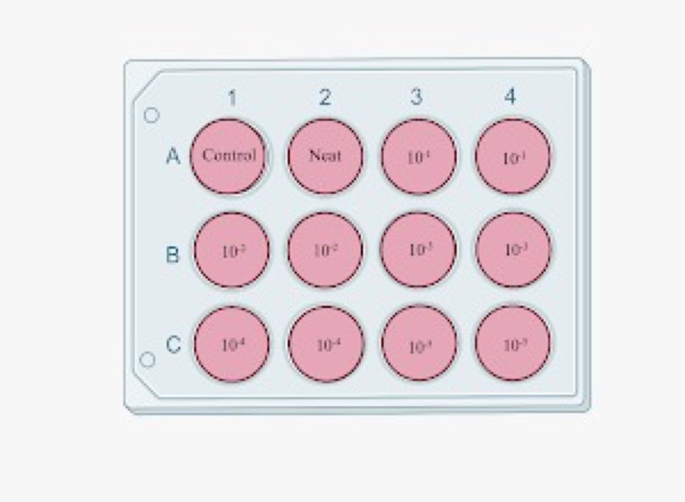
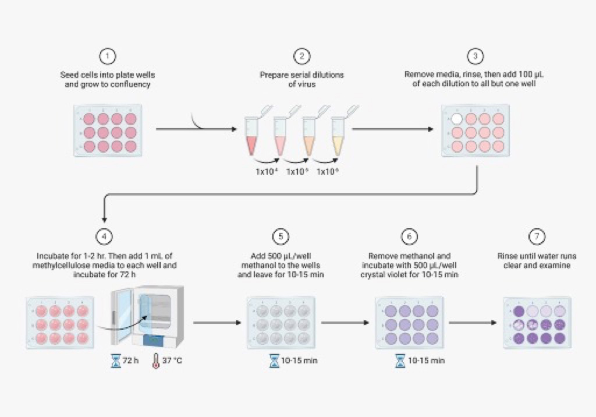

### Theory

A plaque assay is based on the principle that each plaque formed represents one infectious virus particle in the sample. The plaques are the infectious units and cellular dead zones. Plaque assay is the direct quantification of infectious virus particles through counting discrete plaques in cell culture. The semi-solid overlay medium (agar or methylcellulose) restricts viral diffusion, ensuring that the virus spreads only to neighbouring cells through direct contact.

The number of plaques formed is related to the number of infectious units present in the inoculum, and the result is commonly expressed as plaque-forming units per millilitre (PFU/mL).

$$\text{PFU/mL} = \frac{\text{Number of plaques} \times \text{Dilution factor}}{\text{Volume of inoculum (mL)}}$$

The formation of plaques works on the combined role of several components of the assay, viz., the susceptible cells' monolayer and semi-solid media. The host cell monolayers (BHK-21, Vero) are susceptible living cells that support viral attachment, entry, replication, and viral egress, i.e., release of the viral particles. The virus inoculum or supernatant contains the infectious viral particles being quantified, while the cell culture medium provides the nutrients and conditions necessary for cell survival and viral replication. Serial dilution of the virus sample is necessary before infecting the monolayer to achieve a countable number of plaques, allowing for precise estimation of the infectious viral titre. The semi-solid overlay medium, such as agar or methylcellulose, is particularly important because it restricts the movement of newly released virions, limiting infection primarily to neighboring cells and thereby allowing localized plaques to develop. The cells are kept for incubation at 37°C with 5% CO₂; this time allows the virus to infect the cells and release the progeny, which increases the titre.  Following incubation, an appropriate staining or visualization step helps distinguish the infected or damaged regions from the intact cell monolayer, making the plaques visible and countable. For the development or the visualization of the plaque, the cells are first fixed with methanol and then 1% crystal violet solution is used, which stains the intact viable cell layer, which provides clear, uncolored zones (plaques), which indicates virus-induced cellular lysis. Thus, each component of the plaque assay contributes to the formation, visualization, and accurate quantification of plaques.

  

Figure 1. Illustration of Plaque assay.

 

  

Figure 2. 1. Seeding of cells in 12 well plate, 2. Virus serial dilution, 3. Infection in seeded cells, 4. Incubation for 2-3 days, 5. Fixation of cells, 6. Staining the cells, 7. Washing and visualization Confluent monolayer of BHK-21 cells showing distinct viral plaques (clear zones)

 

The plaque assay remains the gold standard for the quantification of infectious viruses in research, vaccine development, and diagnostic applications.